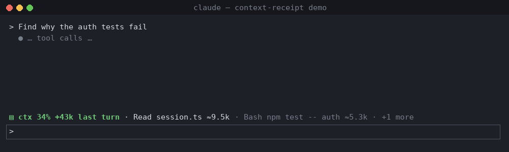

# Claude Code Mods: context receipt & context brake

Two small, observe-first [Claude Code mods](https://claude.dev/blog/getting-started-with-claude-code-mods/) (function-hook plugins) for people who run long sessions and keep getting surprised by the context window.

| Mod | What it does | Reach |
| --- | --- | --- |
| **context-receipt** | After every turn, a one-line band above the prompt says how much the context grew and *which tool results* did it, e.g. `ctx 61% +40k last turn · Read big.log ≈14k · Bash npm test ≈2k`. `/receipt` lists the last turn and the session's biggest results. | Draws and remembers. No files, no network, no processes, no model calls. Never changes a tool call. |
| **context-brake** | When the context crosses your threshold (default 80%), Claude gets **one** short note with your next prompt: finish the current step, stop at a clean boundary, leave a handoff. You get a toast. Re-arms after `/compact` or `/clear`. | Adds one note beside one prompt per fill. Your prompt text is never edited. No files, no network, no processes, no model calls. |



> The GIF is drawn by `scripts/make-demo.py` from band output produced by the real Claude Code runtime (`claude plugin test`, v2.1.301). The window chrome is synthetic; it is not a screen recording of a live session.

## The problem

Context fill drives real decisions mid-session (keep going, delegate, compact, hand off), and the ambient indicator for it keeps disappearing:

- [anthropics/claude-code#90708](https://github.com/anthropics/claude-code/issues/90708) – Desktop app: bring back the context-usage indicator. Users describe sessions hitting auto-compact or "Prompt is too long" with no lead-up.
- Related reports linked from that thread: #91232, #91385 (compaction with no warning), #102094, #102151 (context missing from the usage ring/popover).
- [anthropics/claude-code#91870](https://github.com/anthropics/claude-code/issues/91870) – the Claude Mods proposal, where several users ask for a way to have Claude stop "at a clean boundary and let it compact, rather than have compaction land in the middle of a verification run".

There are already many good context *meters* in the [community catalogue](https://github.com/karanb192/awesome-claude-code-mods) (token-weather, flightdeck, context-band, and others), and `/context` gives an exact category breakdown. These two mods cover what a percentage alone does not:

1. **Attribution per tool result, per turn.** A meter says "61%". The receipt says the 40k jump was one `Read` of a log file, so you know what to avoid next time.
2. **Telling Claude, not only you.** A toast helps if you are watching. The brake puts the information where it changes behaviour: in front of the model, once, before compaction lands mid-task.

Both work in the terminal and the desktop app (the band uses the `AbovePrompt` component; the brake has no UI beyond a toast).

## Install

Requires **Claude Code 2.1.287 or later** (mods are on by default).

From GitHub (after this repo is published):

```text
/plugin marketplace add jonirafael/claude-code-mods
/plugin install context-receipt@claude-code-mods
/plugin install context-brake@claude-code-mods
/reload-plugins
```

From a local clone:

```bash
claude --plugin-dir ./plugins/context-receipt --plugin-dir ./plugins/context-brake
# or
claude plugin marketplace add ./claude-code-mods
claude plugin install context-receipt@claude-code-mods --scope user
```

## Usage

**context-receipt**

```text
/receipt         last turn and the biggest tool results this session
/receipt off|on  hide or show the band
/receipt reset   clear the history
```

Tool-result sizes are estimates (≈4 characters per token) of the text each tool returned to the model; the headline growth (`+40k`) is the real figure from `$.session.usage()`. Results under 50 tokens and subagent-internal tool calls are ignored (a subagent's final report still counts, as the `Agent` call). The band yields to surveys and passes through when there is nothing to show.

**context-brake**

```text
/brake           status: threshold, current fill, armed / sent / waiting
/brake 70        set the threshold (10–99), saved across sessions
/brake off       disable
```

The note Claude receives (once per fill):

> [context-brake] The context window is 83% full and auto-compaction is approaching. Finish the step you are on, then stop at a clean boundary instead of starting large new work. Before stopping, give a short handoff: goal, what is done, what is left, key files and decisions. This is a one-time note from a user-installed mod; the user may run /compact afterwards.

## How it is built

Plain ES modules, no build step, no dependencies:

```
plugins/<mod>/
├── .claude-plugin/plugin.json   manifest (+ "types" contract for $.state)
├── hooks/hooks.json             { "modules": ["./<mod>.mjs"] }
├── hooks/<mod>.mjs              register(on): the hooks
├── hooks/core.mjs               pure logic, unit tested
├── types/index.d.ts             PluginState declarations
└── tests/*.test.ts              run by `claude plugin test`
```

- `context-receipt` hooks `tool.call` (observe: `await next(e)` then measure), `turn.start`/`turn.complete` (main loop only, `!e.agentId`), `session.end`, `command.run`, and `ui.render{component=AbovePrompt}`. History lives in `$.state`, so it survives hot reload, and reading state during render subscribes the band to redraws.
- `context-brake` hooks `turn.complete` to read `$.session.usage()`, and `prompt.submit` to forward the prompt with one extra entry in `context` (the prompt's list of side texts). The threshold is kept in `$.store`.

## Testing

```bash
npm run validate   # claude plugin validate: manifest, hooks, $ calls, state contract
npm test           # claude plugin test: unit + adapter tests against the real runtime
npm run demo       # regenerate the GIF from runtime output
```

Status at v0.1.0, Claude Code 2.1.301 on Linux: validation passes for the marketplace and both plugins; 12 tests pass (8 context-receipt, 4 context-brake). The adapter tests drive the real mods runtime with stubbed `session.usage`, `tool.call` and `prompt.submit`. **Not yet verified in a live, logged-in session** (terminal or desktop). If something renders oddly, run `claude --debug` and please open an issue.

## Privacy

Neither mod reads files, runs processes, calls the network, or calls a model. context-receipt keeps labels such as `Read session.ts` or the first 28 characters of a Bash command in session state; it never stores tool output.

## License

[MIT](LICENSE) © 2026 biqpro SH. Not affiliated with Anthropic.
